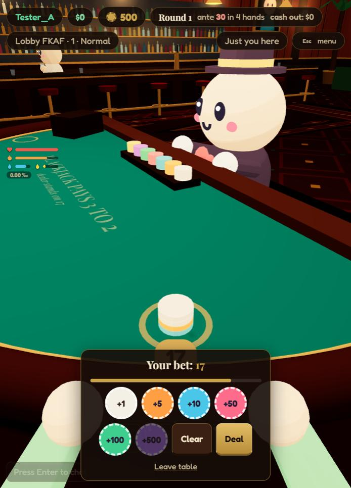
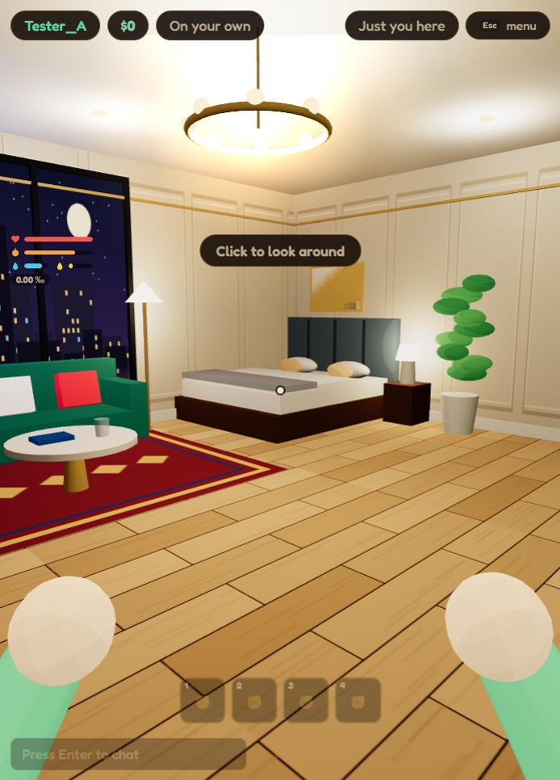
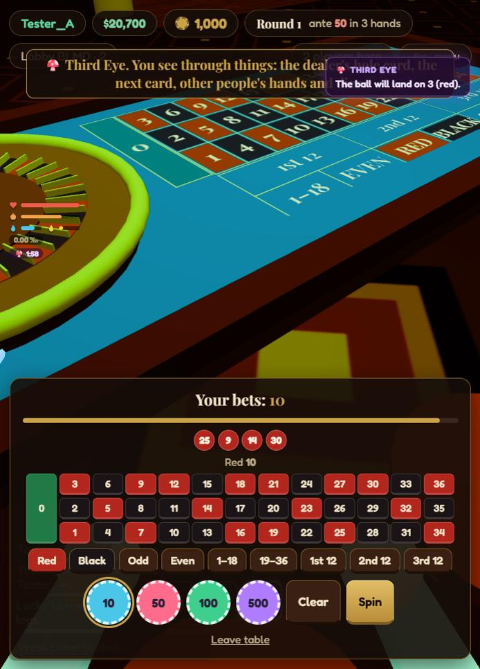
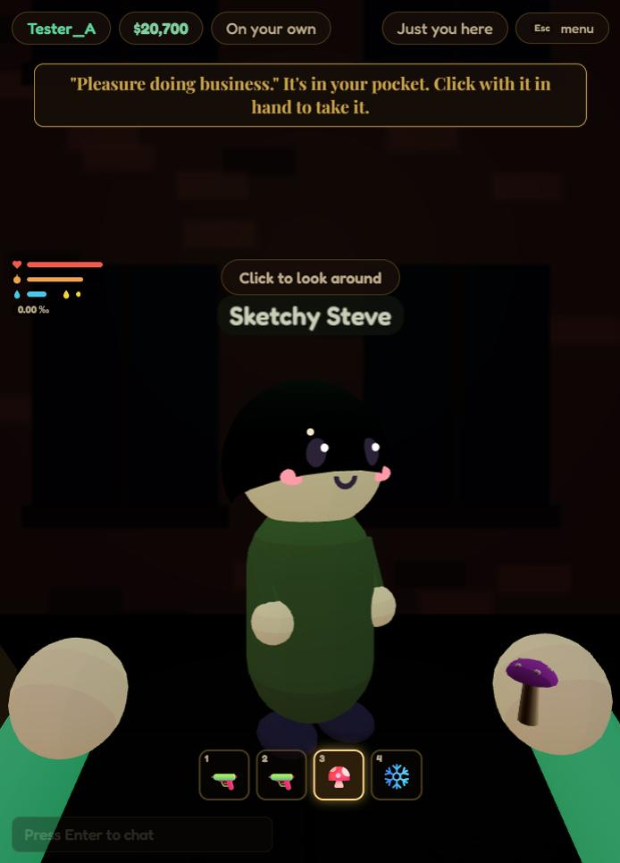
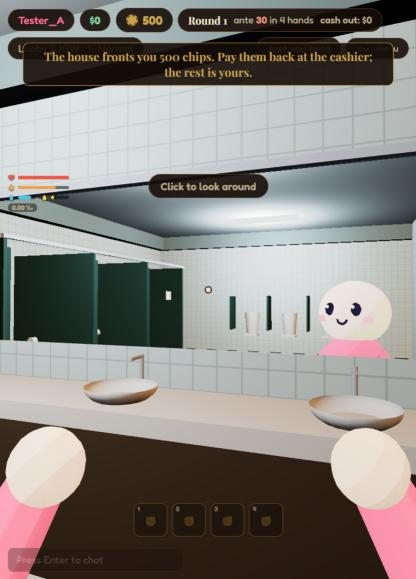
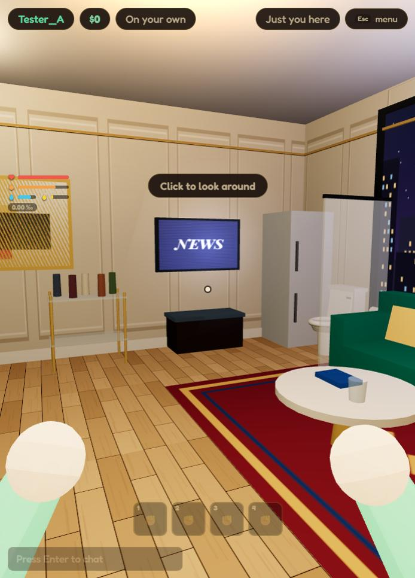

<div align="center">

# 🎰 Bet the Debt

**A first-person roguelike casino you play in the browser with your friends.**

The house lends you 500. The house always collects.


  
  

</div>

---

You wake up in a grotty flat in the Lucky Arms. You walk down the hall, cross the street, and
get a lobby going at the casino doors with your friends. Inside, the house fronts you a small
stack of chips. Every few hands it collects an **ante**, and the ante keeps growing. Cash out
in time and you keep the winnings for good. Can't pay, and two bouncers march you out into
the alley.

The room is dark wood, brass and lamplight; the people in it are bright, silly blobs.
Everything, the cards, the chips, the drinks, the characters, is drawn in code. There are no
downloaded assets.

## Contents

- [Features](#features)
- [Quick start](#quick-start)
- [Playing with friends](#playing-with-friends)
- [How to play](#how-to-play)
- [Controls](#controls)
- [The games](#the-games)
- [Your body, drink and gut feelings](#your-body-drink-and-gut-feelings)
- [The regulars](#the-regulars)
- [Guns, bodies and the restrooms](#guns-bodies-and-the-restrooms)
- [The street](#the-street)
- [Home, the computer and the shop](#home-the-computer-and-the-shop)
- [How it's built](#how-its-built)
- [Tests](#tests)
- [Hosting it in the cloud](#hosting-it-in-the-cloud)

## Features

- 🃏 **Seven games**: Blackjack, Roulette, Baccarat, Texas Hold'em, Liar's Dice, Meyer, and
  Russian roulette in a back room hidden behind a bookcase.
- 👥 **Real multiplayer**: private lobbies of up to 8, each with its own street, apartment
  building and casino. The server runs every game, so nobody can cheat.
- 💀 **Roguelike runs**: a growing ante every round on Easy, Normal or Hard. Cash out in time
  or get walked out back. Dead players haunt the casino as ghosts until the night is over.
- 🍸 **A body to look after**: hunger, thirst, a bladder, and blood alcohol that makes the
  world sway. Drink brings **gut feelings** that are always right, and light up the winning button.
- 🧑‍🤝‍🧑 **Regulars**: seven house characters who wander, play, chat, sulk, and can be invited
  to a game, asked to leave, or threatened out of their chair.
- 🔫 **Guns and consequences**: kill someone where nobody sees, loot the body, hide it in a
  restroom stall. Get seen, and security deals with you.
- 💊 **Street dealers**: Snow, Third Eye and Ice Water, each an edge at the tables.
- 🏠 **A home to upgrade**: bank account and web shop on your home computer; clothes everyone
  sees, furniture, and bigger flats up to a penthouse with a view, a marble bathroom and
  mirrors that actually reflect you.
- 🚪 **One continuous world**: no loading screens. Doors swing open as you walk up to them.

## Quick start

You need [Node.js](https://nodejs.org) **22.5 or newer**. Nothing else (the database is the
SQLite built into Node).

```bash
git clone https://github.com/ChristianOerum/bet-the-debt.git
cd bet-the-debt
npm install
npm run dev
```

Open **http://localhost:5173**, sign up, and you wake up in your flat.

To try multiplayer on your own, use a second browser profile or a private window with a
second account. (Two tabs in the same window share one login.)

## Playing with friends

Build once and run the whole game on one port:

```bash
npm run build
npm start
```

It's now on **http://localhost:3000**.

- **Same Wi-Fi:** friends open `http://YOUR-PC-IP:3000` (find your IP with `ipconfig` or `ip addr`).
- **Over the internet:** the free, account-less option is a Cloudflare quick tunnel. Install
  [`cloudflared`](https://developers.cloudflare.com/cloudflare-one/connections/connect-networks/downloads/)
  (on Windows: `winget install Cloudflare.cloudflared`), then while `npm start` is running:

  ```bash
  cloudflared tunnel --url http://localhost:3000
  ```

  It prints a `https://….trycloudflare.com` link to send your friends. It works while your
  PC and both commands are running, and changes each time.

Accounts live in `server/data/casino.db`. Delete it to wipe everything.

## How to play

1. **Get to the casino.** Walk out of your flat, down the hall, out the front door and across
   the street.
2. **Start a lobby.** Press **E** at the casino doors to talk to the doorman. Start a lobby
   (pick a difficulty and get a 4-letter code to send your friends), or type a friend's code.
3. **Walk in.** The house fronts you **500 chips** and the doors shut behind you.
4. **Play.** Look at a free chair and press **E** to sit. Every few hands the house takes its
   ante, and the ante keeps growing.
5. **Cash out.** At the **cashier**, the barred booth by the entrance, press **E**. The house
   takes back its 500 and the rest becomes **cash** on your account, for good. The top bar
   always shows what you'd walk out with.
6. **Or don't.** Below 10 chips after a hand, the bouncers walk you out back. You haunt the
   casino as a ghost until everyone in your lobby is done, then wake up at home with nothing
   in your pockets.

### Difficulty

Picked with a slider at the doorman when you start a lobby. Everyone in the lobby plays by it.

| | Hands per round | Antes | Your 500 alone runs out in |
|---|---|---|---|
| Easy | 5 | 20, 25, 30, 40, 50, 60 … | round 9 |
| Normal | 4 | 30, 40, 55, 75, 100 … | round 7 |
| Hard | 3 | 50, 80, 110, 170, 250, 380 … | round 5 |

The leaderboard on the casino wall shows everyone's best run with its level ("Round 7 · Easy").
Levels are ranked fairly: a run scores its round, plus 4 on Hard or 2 on Normal.

## Controls

| Key | |
|---|---|
| **WASD** / arrows | walk (arrows also turn) |
| **Shift** / **Space** | run / jump |
| **Mouse** | look around (click the game first) |
| **E** | use what you're facing: a chair, a door, the doorman, the cashier, the bar, a toilet, the fridge, your computer, a regular, a dealer, a body, the red book |
| **Click** | punch, take a bite or sip, take a drug, or shoot, depending on what you're holding |
| **1–4** | hold what's in that hotbar slot (at a table: eat or drink it straight away) |
| **P** | pee (again to stop) |
| **H** | over a body in the restrooms: sit it in a stall |
| **Enter** | chat |
| **Esc** | menu: resume, how to play, controls, leave table, leave lobby, log out |
| **H / S / D / P** | blackjack: hit / stand / double / split |
| **F / C** | poker: fold / check or call |
| **Space** (seated) | Russian roulette: pull the trigger · Meyer: roll |

Seated, the mouse is free for the buttons; drag on the scene to look around the table.

## The games

The casino has a **main hall** (three Blackjack tables, Roulette, the bar), a **card room**
through the great arch (Texas Hold'em, Baccarat, a fireplace and walls of books), a **dice
parlour** through the neon arch (Liar's Dice, Meyer), and a **back room** behind a bookcase.
Pull the red book.

Chips come in **1, 5, 10, 50, 100, 500, 1K, 5K, 10K and 25K**. The big ones appear once you
could afford one. Table limits run from 10 to 100,000.

| Game | Rules in short |
|---|---|
| **Blackjack** | 6 decks, up to 5 players. Turns go round the table one move at a time. Dealer stands on 17, blackjack pays 3:2 (an odd bet rounds down). Double on any two cards, split a pair once. |
| **Roulette** | European wheel. A number pays 35:1; red/black, odd/even, 1–18/19–36 pay evens; a dozen pays 2:1. |
| **Baccarat** | Bet on Player, Banker or Tie. Player pays evens, Banker 19:20, Tie 8:1. |
| **Texas Hold'em** | No-limit, blinds 10/20, up to 5 players, side pots handled. |
| **Liar's Dice** | Everyone pays 100 and hides five dice. Bid how many of a face are on the table (ones wild) or call a lie. Wrong loses a die; the last one with dice takes the pot. |
| **Meyer** | Everyone pays 100 and has 3 lives. Roll in secret, call what you rolled (or lie); it must beat the last call. Meyer (2-1) beats all. Last one alive takes the pot. |
| **Russian roulette** | No stake but your life. One bullet, six chambers. The survivors split everything the loser carried. |

Walking away from a game you're in counts as losing it.

## Your body, drink and gut feelings

Health, food, water and bladder sit in the corner, with your blood alcohol in ‰.

- **Food and drink** come from the **bar** in the casino (for chips) or the **fridge** at home
  (free, and you get what you pay for). They go in your four-slot **hotbar**; click to take a
  bite or a sip. Every item is a little 3D model in your hand, from a pint of stout to a
  flaming cocktail.
- **Run out** of food or water and your health drains. Zero health on a run is death.
- **Pee** with **P**, ideally at a toilet. Miss one in the casino and the cleaner bills you 50 chips.
- **Drink** makes the world sway and blur, and from 3.0 ‰ every drink can kill you (at 3.5 ‰ it will).
- **Gut feelings** come with drink, and they are **always right**: stand or hit, red or black,
  stay in or fold, believe or call the lie. The winning button lights up purple. The chance of
  one at your next decision shows under your ‰. It grows with every ‰, and with every decision
  that passes without one, until one comes.

| | fresh | after 1 miss | 2 | 3 |
|---|---|---|---|---|
| 0.5 ‰ | 20% | 31% | 42% | 53% |
| 1 ‰ | 30% | 44% | 58% | 72% |
| 2 ‰ | 50% | 70% | 90% | 100% |

## The regulars

Seven house characters: Big Sal, Granny Hex, Nervous Ned, Doug and friends. They stroll about,
play at the tables, and talk (it floats over their heads). Their chips are real: what you win
off them is yours.

- **Walk up and press E** to invite one to a game they like, at a table in the room you're in.
- **Walk up to one in a chair** to ask them to give it up nicely, or to threaten them.
- Only the brave will play **Russian roulette**, and only with a real person.

## Guns, bodies and the restrooms

- **Two pistols** on the home shop: a loud one ($2,500) and one with a suppressor ($6,000).
  Guns only work inside the casino. Two hits kill.
- **Whatever you carry into the casino, you lose if you die there**: chips, food, drugs, and
  your guns. It all stays on your **body** for anyone to loot with **E**.
- **Security sees everything on the floor.** Anyone who witnesses a killing (a player, a
  regular, the staff) gets you walked out back. A loud pistol is heard all over the casino.
- **The restrooms**, through the door in the main hall's left wall, are the one place nobody
  outside can see into. The walls muffle a loud pistol to anyone but those right by the door;
  a suppressed one isn't heard at all. Press **H** to sit a body in a stall. A body left in the
  open is found within a minute, and the cameras give the killer away.
- **Getting someone in there:** regulars use the restrooms on their own now and then. Play
  3 hands with one and you can ask them to *"step into the bathroom with me a minute"*.

## The street

Two dealers lurk at the dark ends of the street. Cash only, and not while you're on a run.

| | | |
|---|---|---|
| ❄️ **Snow** | $300 | Every decision comes with a gut feeling, and every one is right. 3 minutes. |
| 🍄 **Third Eye** | $500 | See through things: the hole card, the next cards, other hands, all the dice, where the ball will land. 2 minutes. |
| 💊 **Ice Water** | $400 | No wobble, no blur, no bladder, and the drink can't kill you. 3 minutes. |

## Home, the computer and the shop

Your flat starts as a studio with a mattress on the floor, a TV full of static and a cockroach.
The **computer** on the desk runs LuckyOS (the password is on the sticky note):

- **Lucky Bank**: your balance and a statement of every cash-out and purchase.
- **Shoddy.com**: clothes (a fedora, shades, a gold suit, a chain…) that everyone sees you
  wearing; things for the home (a real bed, a TV with a picture, a neon sign, a roach motel);
  the two pistols; and **bigger flats**. The one-bedroom ($5,000) and the **penthouse**
  ($20,000) each come with a bathroom of their own, with a mirror that shows you. The
  penthouse has parquet, a wall of glass onto the city at night, a chandelier, a bar cart and
  marble.

Friends in your lobby live in the same building. Walk down the hall and visit.

## How it's built

| | |
|---|---|
| **Browser** | Three.js (WebGL) + Vite, TypeScript, plain HTML/CSS for the HUD |
| **Server** | Node + Express + Socket.IO, run with `tsx` |
| **Database** | SQLite via Node's built-in `node:sqlite`, behind a small `Store` interface |
| **Tests** | Vitest |

The server is the authority on everything: it holds the decks and dice, owns every balance,
checks every move and decides who gets shot. Browsers only say what they'd like to do, and
your hole cards and dice are only ever sent to you.

```
shared/   rules and message types used by both sides
  src/run.ts          runs, antes, difficulty levels, cashing out (and the game's name)
  src/world.ts        the floor plan: rooms, doors, tables, the street, the flats, the restrooms
  src/vitals.ts       hunger, thirst, bladder, blood alcohol, the bar menu, gut-feeling odds
  src/combat.ts       guns, witnesses, drugs, bodies
  src/shop.ts         what the shop sells
  src/bots.ts         how the regulars play each game
  src/protocol.ts     every message between browser and server
  src/games/          the rules of each game
server/
  src/hub.ts          who's online; lobbies
  src/instance.ts     one lobby's world: movement, chips, runs, deaths, bodies, security
  src/patrons.ts      the regulars
  src/games/          one table class per game
  src/store/          accounts, bank, what people own (SQLite)
client/
  src/main.ts         the game loop and input
  src/world/          the 3D world: casino, rooms, street, flats, characters, doors, mirrors
  src/games/          one 3D table and button panel per game
  src/ui/             HUD, login, chat, menus, the home computer, item icons
```

### Adding a game

1. **Server:** extend `TableBase` (or implement `GameTable`) and register it in
   `server/src/games/registry.ts`. Call `ctx.handFinished(playerId)` when a hand is paid; the
   casino handles antes and the shooting. Add `botMove` so regulars can play it, and
   optionally `gutFeeling` and `peek` for hunches and the Third Eye.
2. **Browser:** extend `TableView` (or implement `GameView`) and register it in
   `client/src/games/registry.ts`.
3. **Place it:** a table shape in `SHAPES` and a spot in `STATIONS` (`shared/src/world.ts`).

Seating, chips, chat and networking are already handled.

To rename the game, change `GAME_NAME` in `shared/src/run.ts`. Every sign, screen and tab follows.

## Tests

```bash
npm test
```

Covers the run rules and difficulty levels, every game's rules and payouts, full games played
at each table, that gut feelings are always right, the regulars, walking (from every bed to
the casino, through every door, with locked doors locked), guns, witnesses and the
restrooms, looting, drugs, the bank and the shop.

## Hosting it in the cloud

The same commands work on a host such as Render: build with `npm install && npm run build`,
start with `npm start`. The host sets the port.

Free hosts usually wipe local files on restart, which would reset `casino.db`. Either attach a
persistent disk and point `DB_PATH` at it, or add a second implementation of the `Store`
interface (`server/src/store/Store.ts`) for a hosted database. No game code needs to change.
